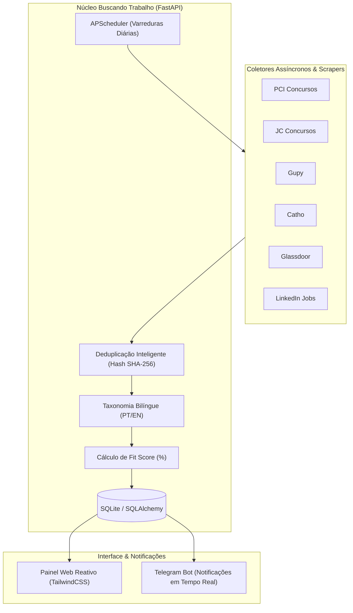

# 💼 Buscando Trabalho - Monitor Inteligente de Vagas & Concursos Públicos

[](https://www.python.org/)
[](https://fastapi.tiangolo.com/)
[](https://www.sqlite.org/)
[](https://tailwindcss.com/)
[](https://core.telegram.org/bots/api)
[](https://www.docker.com/)
[](LICENSE)

Uma aplicação web *self-hosted* full stack, moderna e orientada a serviços desenvolvida em **Python (FastAPI + SQLAlchemy + SQLite)** com frontend reativo em **HTML5, TailwindCSS e JavaScript**. O sistema foi concebido para centralizar a busca por oportunidades de trabalho tanto no **Mercado Privado** quanto no setor de **Concursos Públicos**, integrando raspadores automatizados, inteligência de ranqueamento de perfil e alertas em tempo real via **Telegram Bot**.

---

## 🎯 Visão Geral & Proposta do Projeto

Buscar emprego exige consultar diariamente dezenas de plataformas com interfaces lentas, anúncios repetidos e sem controle unificado de histórico. O **Buscando Trabalho** resolve esse problema ao agregar:



---

## 🚀 Funcionalidades Principais

### 1. 💼 Vagas do Mercado Privado (Multi-Plataforma)
- **Varredura Integrada**: Busca simultânea de vagas em múltiplos portais de ponta (**Gupy, Catho, Glassdoor, LinkedIn**).
- **Expansão Taxonômica Bilíngue**: Ampliação automática de termos de busca (ex: ao buscar *"Analista de Suporte"*, termos como *"Help Desk"*, *"Desktop Support"* e variantes em inglês/português são explorados).
- **Cálculo de Match / Fit Score**: Algoritmo que cruza as competências e histórico do candidato (*Candidate Profile*) com a descrição de cada oportunidade, gerando pontuação percentual de aderência.
- **Deduplicação Inteligente Cruzada**: Detecção de uma mesma vaga anunciada em diferentes portais, agrupando links em uma única oportunidade e consolidando dados de salário e modelo de trabalho.
- **Filtros e Badges PCD**: Classificação visual de vagas entre **Ampla Concorrência**, **Afirmativa PCD** e **Exclusiva PCD**.
- **Gestão de Status & Interesse**: Controle pessoal do ciclo da candidatura (*Nova*, *CV Gerado*, *Aplicado*, *Entrevista*, *Aprovado*, *Descartado*) e organização rápida de interesse (*Interesse*, *Pendente*, *Sem Interesse*).
- **Filtro de Modelo de Trabalho**: Visualização rápida para vagas **100% Remotas**, **Híbridas** ou **Presenciais**.

### 2. 🏛️ Monitor de Concursos Públicos
- **Monitoramento por Município**: Cadastro de cidades e estados de interesse (ex: *Sumaré/SP*, *Campinas/SP*, *Hortolândia/SP* etc.).
- **Raspadores Automáticos**: Extração estruturada de editais oficiais em portais de referência (**PCI Concursos** e **JC Concursos**).
- **Visualização Centralizada**: Tabela com vagas, escolaridade, salários, status do edital e link direto para a página oficial do certame.
- **Disparo Manual ou Agendado**: Possibilidade de disparar varredura imediata com um clique ou aguardar o cron job matinal.

### 3. 📢 Central de Notificações via Telegram
- **Alertas Automáticos em Tempo Real**: Mensagens formatadas em HTML enviadas diretamente para o seu chat pessoal ou canal no Telegram assim que uma nova vaga compatível ou edital municipal for encontrado.
- **Configuração Simplificada**: Suporte à configuração via arquivo `.env` ou interativamente pelo próprio painel web com botão de teste imediato de conectividade.
- **Agendamento Diário (APScheduler)**: Rotinas em background que executam a verificação nos horários configurados (padrão: 07:00 para concursos e 08:30 para vagas privadas).

### 4. 📚 Edital Verticalizado & Guia de Estudos
- **Acompanhamento Metódico**: Cadastro de cargos-alvo com estruturação por disciplinas e tópicos de edital.
- **Métricas de Desempenho**: Controle percentual de leitura de teoria, contador de revisões periódicas e taxa automática de acerto de questões resolvidas.

---

## 🛠️ Stack Tecnológica & Arquitetura

- **Linguagem**: Python 3.11+
- **Backend**: FastAPI, Starlette, Pydantic v2
- **Banco de Dados**: SQLite com SQLAlchemy ORM (Session local, migrações idempotentes e suporte a transações assíncronas)
- **Agendador de Tarefas**: APScheduler (AsyncIOScheduler com triggers Cron)
- **Web Scraping & Requisições**: BeautifulSoup4, httpx
- **Frontend**: HTML5 semântico, TailwindCSS (dark mode moderno), FontAwesome 6
- **Deploy**: Dockerfile multi-stage, Docker Compose, otimizado para Proxmox LXC ou VPS

---

## 💻 Como Executar Localmente

### Pré-requisitos
- Python 3.11 ou superior instalado
- Git

### 1. Clonar o repositório
```bash
git clone https://github.com/Renan-Rodolfo/concurso_monitor.git buscando_trabalho
cd buscando_trabalho
```

### 2. Criar e ativar o ambiente virtual
```bash
# Windows (PowerShell)
python -m venv venv
.\venv\Scripts\Activate.ps1

# Linux / macOS
python3 -m venv venv
source venv/bin/activate
```

### 3. Instalar dependências
```bash
pip install -r requirements.txt
```

### 4. Configurar variáveis de ambiente
Copie o arquivo de exemplo:
```bash
cp .env.example .env
```

### 5. Iniciar a aplicação
```bash
uvicorn app.main:app --reload --host 127.0.0.1 --port 8000
```
Acesse no navegador: **`http://localhost:8000`**

---

## 🐳 Deploy com Docker / Docker Compose

Esta aplicação está 100% pronta para execução conteinerizada em servidores Linux, VPS ou containers LXC no **Proxmox VE**.

### Subir os containers
```bash
# Criar diretório de dados persistente
mkdir -p data

# Construir e iniciar o container em background
docker compose up -d --build
```

### Comandos úteis de monitoramento
```bash
# Ver status do container
docker compose ps

# Acompanhar logs em tempo real
docker compose logs -f concurso-monitor

# Reiniciar serviço
docker compose restart
```

---

## 🤖 Como Configurar o Bot do Telegram

Para receber as notificações no seu smartphone ou desktop:

1. **Criar o Bot**:
   - Abra o Telegram e inicie uma conversa com [@BotFather](https://t.me/BotFather).
   - Digite `/newbot`, escolha o nome do bot e o seu username (ex: `MeuMonitorVagasBot`).
   - Copie o **HTTP API Token** gerado.

2. **Obter seu Chat ID**:
   - Inicie uma conversa com [@userinfobot](https://t.me/userinfobot) no Telegram.
   - Ele responderá com o seu identificador numérico (**Id**).

3. **Vincular na Aplicação**:
   - Abra a interface web em `http://localhost:8000`, clique na aba **Alertas Telegram**, insira o Token e o Chat ID e clique em **Testar Envio**.

---

## ⚙️ Variáveis de Ambiente (`.env`)

| Variável | Descrição | Padrão |
| :--- | :--- | :--- |
| `DATABASE_URL` | URI de conexão SQLite | `sqlite:///./data/concursos.db` |
| `TELEGRAM_BOT_TOKEN` | Token HTTP da Telegram Bot API | `-` |
| `TELEGRAM_CHAT_ID` | Identificador de chat/usuário para alertas | `-` |
| `TELEGRAM_ENABLED` | Ativação do envio de mensagens | `true` |
| `SCRAPER_CRON_HOUR` | Hora de varredura diária de concursos (0-23) | `7` |
| `SCRAPER_CRON_MINUTE` | Minuto de varredura de concursos (0-59) | `0` |
| `JOB_SEARCH_CRON_HOUR`| Hora de varredura de vagas privadas (0-23) | `8` |
| `JOB_SEARCH_CRON_MINUTE`| Minuto de varredura de vagas privadas (0-59) | `30` |

---

## 🔒 Segurança & Privacidade para Repositório Público

- **Zero Hardcoded Secrets**: Nenhuma chave de API, credencial ou token privado está versionado no código-fonte.
- **Isolamento de Dados Locais**: O arquivo de banco SQLite (`data/*.db`) e variáveis de ambiente (`.env`) estão listados no `.gitignore`.
- **Privacidade do Usuário**: A aplicação não envia dados telemétricos nem informações para servidores de terceiros além das chamadas diretas aos portais públicos de vagas e à API oficial do seu próprio bot no Telegram.

---

## 🧪 Testes Automatizados

O projeto conta com suíte de testes unitários e de integração:

```bash
python -m unittest discover -s tests
```

---

## 📄 Licença

Distribuído sob a licença **MIT**. Consulte o arquivo [LICENSE](LICENSE) para mais detalhes.

---

<p align="center">
  <b>Buscando Trabalho</b> · Desenvolvido com foco em produtividade, automação e arquitetura limpa.
</p>
